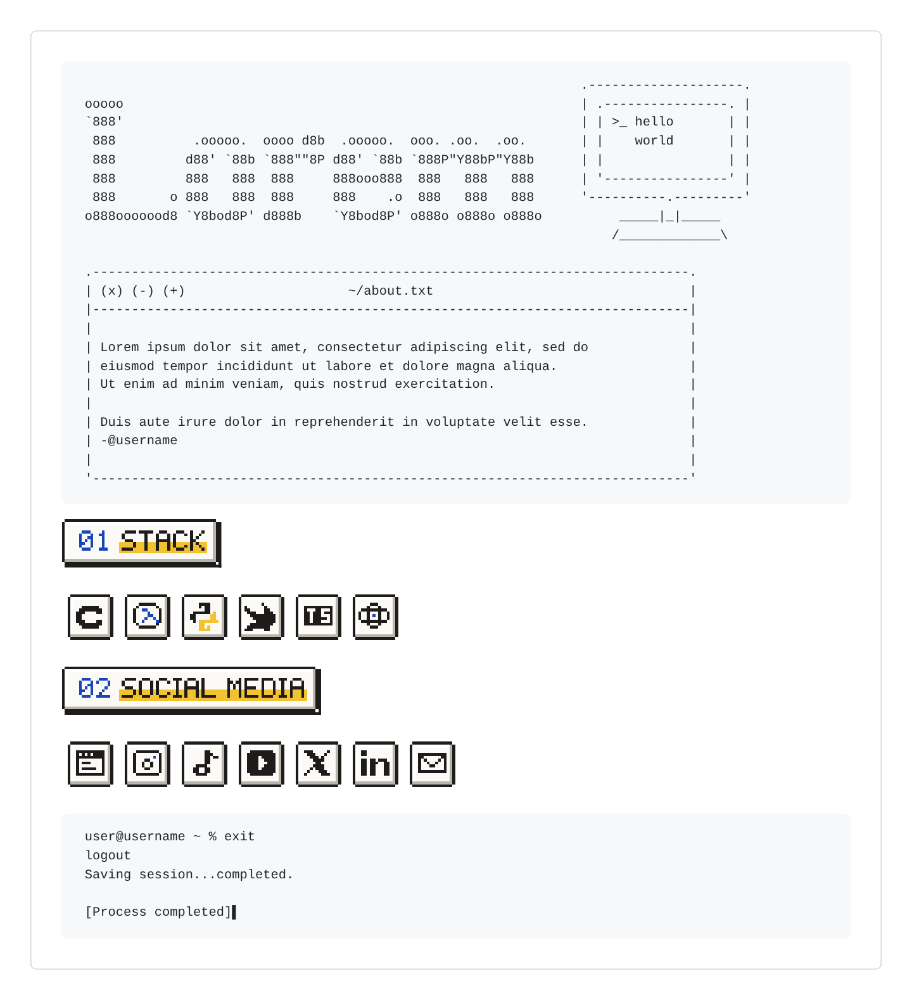
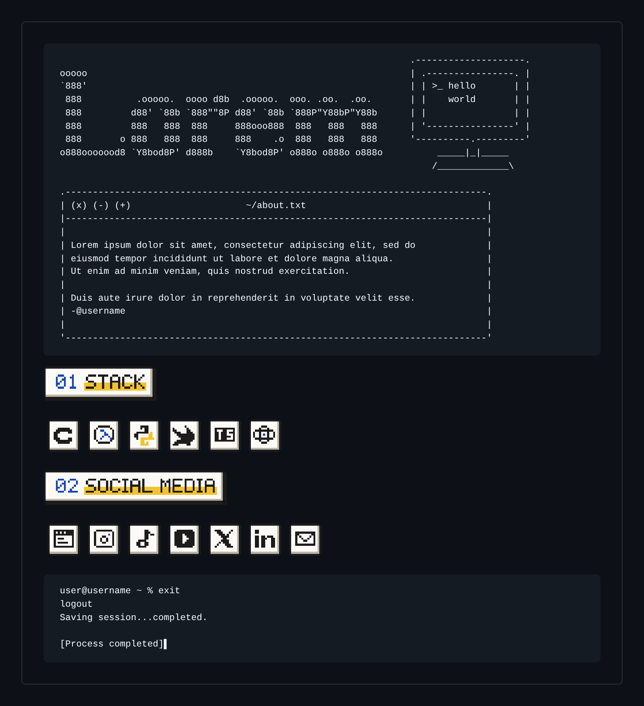

# retro-profile-readme

An [Agent Skill](https://agentskills.io/specification) that turns your GitHub profile into
a retro page: big ASCII name, optional art, a little Mac window with your bio, pixel icons
and a terminal sign-off.

<table>
  <tr>
    <th>Light theme</th>
    <th>Dark theme</th>
  </tr>
  <tr>
    <td></td>
    <td></td>
  </tr>
</table>

## Install

Clone it into your agent's skills folder (the folder must be named `retro-profile-readme`):

```bash
git clone https://github.com/devcelio/retro-profile-readme ~/.claude/skills/retro-profile-readme
```

- **Claude Code:** `~/.claude/skills/` as above
- **Cursor:** `~/.cursor/skills/`
- **Codex:** `~/.agents/skills/`
- **Claude.ai:** zip the folder, then Customize > Skills > Upload a skill

## Usage

Just ask your agent: *"make my GitHub profile README retro"*. It will ask you what it needs
(your name, art, bio, stack, links), with options to pick from, and show you a light and
dark preview before publishing anything. Say "you pick" whenever you don't care.

For art, there's a small gallery of Pokémon and anime pieces in
[`examples/art/`](examples/art/), or you can bring your own from
[emojicombos anime](https://emojicombos.com/anime-ascii-art) and
[emojicombos Pokémon](https://emojicombos.com/pokemon-ascii-art).

Prefer doing it by hand? Copy [`examples/profile.json`](examples/profile.json), see
[references/config.md](references/config.md) for every option, and run
`python3 scripts/build.py profile.json --out ../<username>`.

## License

MIT, see [LICENSE](LICENSE). The pieces in `examples/art/` belong to their artists and
aren't covered by it; see [their README](examples/art/README.md).
