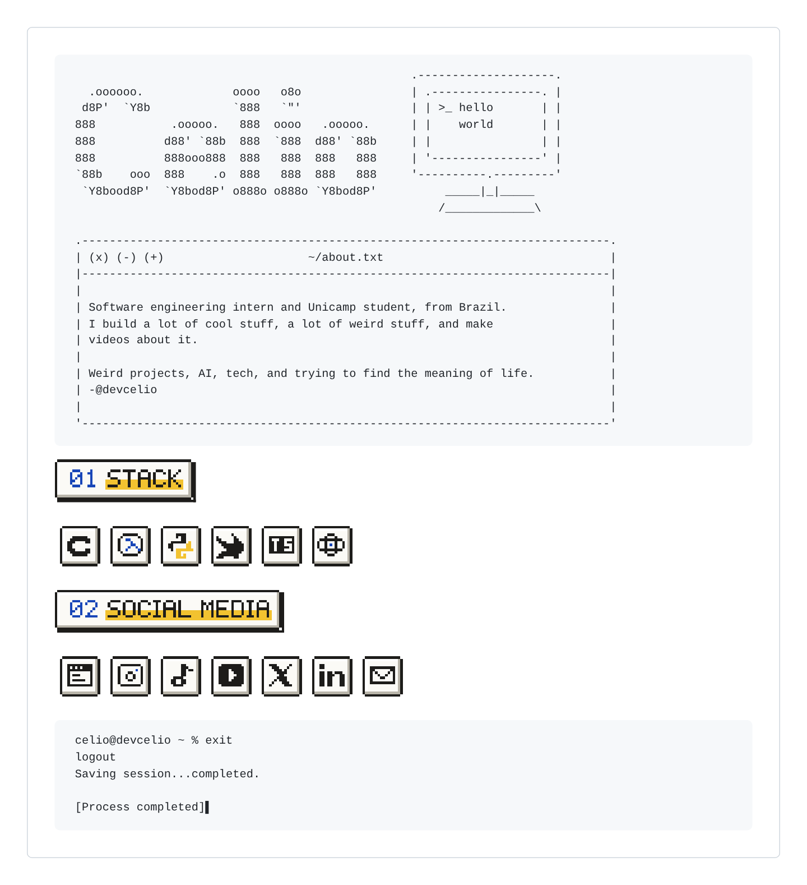

# retro-profile-readme

An [Agent Skill](https://agentskills.io/specification) that builds a retro GitHub profile
README: a big ASCII name, optional side art, your bio inside a little Mac window, pixel-art
headings and icon tiles for your stack and socials, and a terminal that logs out at the end.



It works with Claude (Claude Code and Claude.ai), Cursor, Codex and anything else that reads
the `SKILL.md` format. Ask your agent something like *"make me a retro GitHub profile README"*
and it will collect your details, write a config and run the scripts.

## Install

Replace `devcelio` with the GitHub account that hosts this repo. The folder has to be named
`retro-profile-readme`.

**Claude Code**

```bash
git clone https://github.com/devcelio/retro-profile-readme ~/.claude/skills/retro-profile-readme
```

Use `.claude/skills/` inside a project instead if you only want it there.

**Claude.ai**

Download the repo as a ZIP (or zip the `retro-profile-readme` folder yourself), then go to
Customize > Skills > + > Create skill > Upload a skill. Code execution has to be on.

**Cursor**

```bash
git clone https://github.com/devcelio/retro-profile-readme ~/.cursor/skills/retro-profile-readme
```

Project-level `.cursor/skills/` or `.agents/skills/` work too.

**Codex**

```bash
git clone https://github.com/devcelio/retro-profile-readme ~/.agents/skills/retro-profile-readme
```

Or put it in `.agents/skills/` in your repo. Call it with `$retro-profile-readme` or pick it from `/skills`.

## Run it yourself

```bash
pip install pyfiglet
cp examples/profile.json my-profile.json        # edit it
python3 scripts/build.py my-profile.json --out ../<username>

# optional: light and dark screenshots plus a few layout checks
pip install playwright && playwright install chromium
python3 scripts/preview.py ../<username>
```

Commit `README.md` and `imgs/` to the repo named after your username. Every config key is
documented in [references/config.md](references/config.md).

## Side art

The picture next to your name is up to you. Good places to find one:

- https://emojicombos.com/anime-ascii-art
- https://emojicombos.com/pokemon-ascii-art

Paste the one you like into a text file (say `side-art.txt`) and point `side_art` at it.
Short pieces, around 7 to 12 lines and under 30 columns, fit best. Braille art is fine; the
script lines it up so it can't break the name.

This repo doesn't ship anyone else's art. The little computer in `examples/side-art.txt` was
drawn for this project. Art from those sites belongs to whoever made it, so credit the artist
or check their terms when you use it, and remember that characters like Pokémon are someone
else's trademark.

## What's inside

```
SKILL.md                 instructions the agent follows
scripts/build.py         config -> README.md + SVGs
scripts/preview.py       light/dark screenshots and checks
scripts/glyphs.json      pixel icons and the 5x7 heading font
references/config.md     every config key, custom icons
examples/                sample config and side art
assets/preview.png       the image above
```

## License

MIT, see [LICENSE](LICENSE).
